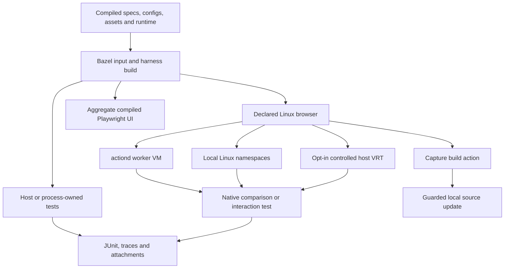

# Architecture

Consumers build apps/specs and validate types. Bazel prepares immutable harnesses
and owns execution, caching, retries, shards, and deadlines. Playwright owns
fixtures, contexts, assertions, and screenshot comparison.

## Ownership

| Layer | Owns |
| --- | --- |
| Consumer | Compiled specs/configs, built assets, servers, executables, fonts, fixtures, baselines, and typechecks |
| Bazel rules | Runfiles, harnesses, runtime layouts, input platforms, actions, and test lifecycle |
| TypeScript runtime | Package/browser checks, server lifecycle, scratch cleanup, reports, and guarded updates |
| Consumer CI | Worker/browser provisioning, environment parity, scheduling, uploads, and baseline review |

Frameworks, bundlers, providers, authentication, and deployment conventions stay
in the consumer repository. Browser runtime/build tools use TypeScript, rules_ts,
and rules_js; runfile lookup uses `@bazel/runfiles`.

## Execution paths

Actiond and local Linux modes use declared runtimes and loopback-only fixtures.
Actiond supplies its pinned libc/Bash and supports x64 interactions plus x64/ARM64
VRT. Local Linux uses namespaces and declared loader/libraries on x64/ARM64.
`host_vrt` uses a controlled Linux amd64 host environment without VM isolation.
Host/process-owned tests inherit caller Bazel execution policy and host networking.
See [execution modes](api.md#execution-modes).

VRT comparison is a native Bazel test. Capture is a build action; `.update`
applies successful, nonempty results with edit/concurrency checks. Host suites
can separately own snapshots and filtered updates. No normal comparison writes
source references.

## Built input boundary

`browser_shell` supplies one built asset directory, not producer/compiler
runfiles. Compiled spec/config targets supply defaults and runtime dependencies.
Default `runtime_only` filtering removes source/type/debug inputs while preserving
npm packages and explicit `data`. Browser tests do not request semantic
`transitive_typecheck` outputs; consumers run those validation targets separately.

Declare ESM package markers, imports, generated CSS, executable permissions, and
npm links. The runner does not discover packages, repair dependency links, copy
harness code, or rewrite executable layouts. `playwright_runtime` must select
physical packages matching consumer imports; build-time validation checks versions.

Each target builds an immutable suite harness containing config, helpers, package
metadata, and generated capture specs. Runfiles resolve consumer paths across
repositories. Dynamic URLs, discovery, working snapshots, caches, and reports
remain execution state. Scratch cleanup retains failure artifacts.

Server adapters own readiness/teardown; config-only targets use native `webServer`.
Process-owned specs select and close their own executables. Aggregate UI builds
its own compiled bundle and shared config; it does not merge per-suite servers.

## Implementation map

- [Public API](api.md): rules, attributes, runtime descriptors, and TypeScript exports.
- [Shared macros](../internal/browser.bzl): inputs, harnesses, and execution selection.
- [Declared execution](../internal/remote.bzl): transitions, tests, and captures.
- [Local namespaces](../internal/local/launch.bzl): mounts and launchers.
- [UI aggregation](../internal/ui.bzl): compiled suite bundles.
- [Runner](../runtime/runner.ts): processes, reports, and cleanup.
- [Source updates](../internal/snapshots.bzl): snapshot capture and guarded writers.
