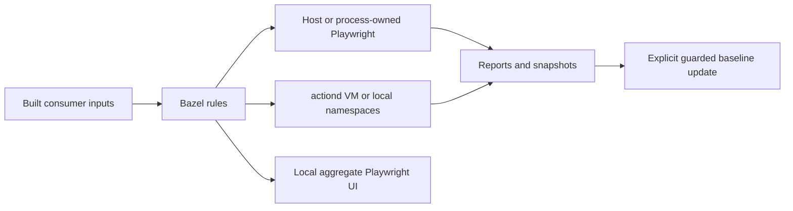

# Scope and roadmap

[API reference](api.md) covers the supported public rules and contracts:

- Managed/deployed E2E, component mounts, and process-owned Electron/browser tests.
- Native screenshot specs and gallery-generated visual captures.
- Actiond VMs, local Linux namespaces, host interaction tests, and controlled host VRT.
- Pinned browser/worker presets, custom runtimes, fonts, and optional video helpers.
- Native Bazel caching, retries, shards, filters, JUnit, and failure artifacts.
- Guarded VRT updates, host snapshot export/updates, and aggregate Playwright UI.

Consumers own builds, typechecks, frameworks, fixtures, and baseline review.

## Remaining limits

Actiond ARM64 interaction tests remain unsupported; local Linux ARM64 supports
interactions and VRT. Apple Silicon VM evidence is recorded in the
[ARM64 guide](macos-arm64-vrt.md). Pixel equivalence across architectures and
execution modes remains unverified; review separate baselines.

Generic `playwright_test`, `web_visual_test`, and Starlark `component_visual_module`
macros are not exported. Use `visual_test` for page screenshots and TypeScript
`ComponentVisualModule` for galleries. UI supports compiled managed E2E suites;
component/process/VRT suites and source-mode execution are unsupported.

Extensions must preserve declared inputs, execution boundaries, baseline
ownership, and useful failure artifacts.
